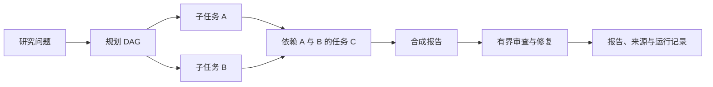

# Deep Research Agent：项目讲解与演示

更新：2026-10-26。当前阶段以理解、演示和表达为主；不追加新机制，不为准备材料重复调用模型或运行测试。

## 从哪里开始

1. [当前三条简历描述](resume-deep-research-agent.md)：只使用文件顶部的当前版。
2. 读下面的项目介绍与三条主线，再沿代码入口梳理一次数据流。
3. 用已有记录练习演示；被问到实现细节时能定位代码和解释取舍，再逐项加深。

材料是代码对应的讲解提纲，不能代替自己理解和实际回答。

## 一到两分钟介绍提纲

这个项目面向需要查询多个来源、整合信息并检查结论的研究任务。单次问答不便控制研究步骤、复用中间结果和追踪错误，所以我把流程拆成规划、研究执行、报告合成和审查几个阶段。

第一条主线是调度。规划器输出带依赖的任务图，执行器按层并发研究，用 Semaphore 限制调度并发；每层结束发布结果，并把依赖结果注入下游上下文。执行中区分临时错误重试与方案重规划，同时保留成功结果，并为最终合成预留时间。

第二条主线是研究记忆与上下文控制。SQLite 保存研究信息，NumPy 向量索引配合真实 Embedding 做检索；在上下文增长时使用相关性筛选、TextRank 与分级摘要。压缩会损失信息，因此保留来源关联，并明确预算取舍。

第三条主线是证据审查。Red 给出带位置、类型和证据的问题，Blue 根据问题修正、补检或删除无依据内容，修改后再复核，记录版本并限制轮次和调用数。它是有界的改进机制，不保证所有事实正确。

一个实际处理过的问题是：研究已经取得来源，后续读页失败或超额搜索却让整个子任务失败，已有证据无法进入最终报告。现在错误会回传并保留先前证据，让任务在预算内收尾；没有任何有效来源时仍失败。

## 三条主线：需要讲清什么

| 主线 | 需求与方案 | 代码入口 | 必须掌握的取舍 |
| --- | --- | --- | --- |
| DAG 异步编排 | 依赖任务获得上游结果，独立任务可并发；按层发布结果、有界重试与重规划、最终收尾 | [编排器](../src/orchestrator/orchestrator.py)、[规划器](../src/planner/planner.py)、[研究 Agent](../src/agents/researcher.py) | 当前按层执行，慢任务可能拖住下一层；Semaphore 限制协程调度，不保证已取消的底层请求立即消失。 |
| 共享记忆与压缩 | 在 Agent 之间复用已有研究信息，控制重复内容和上下文增长 | [共享记忆](../src/memory/memory_store.py)、[压缩器](../src/compressor/compressor.py)、[来源登记](../src/utils/sources.py) | SQLite 是持久化研究记忆；NumPy 是内存向量索引；不是 checkpoint 恢复系统。压缩及 2,000 字符摘录有信息损失，不等于程序错误。 |
| Red–Blue 审查 | 将问题定位和修复操作分开，保留来源与修改前后版本；复核后再接受候选 | [审查循环](../src/adversarial/loop.py)、[Red](../src/adversarial/red_agent.py)、[Blue](../src/adversarial/blue_agent.py) | 不依靠自评分证明事实正确；审查结束不等于问题全部解决。轮次、调用与片段预算应解释收益及代价。 |

### 异步编排：读代码时画出这条链



这是依赖图示意，不代表每次模型都生成这个图。结合 `_do_dispatching`、`_publish`、`_build_task_context` 看实际执行位置。

要能说明：为什么只做拓扑排序还不够；结果什么时候可见；哪些错误重试、哪些触发重规划；超时后如何利用已有结果；为什么 `asyncio` 中同步 SDK 调用需要移出事件循环。

### 共享记忆与压缩：避免混淆的四件事

- 语义相似不等于事实相同。当前去重先用相似度找候选，再比较规范化文本，不能自动合并不同数字或否定结论。
- 会话隔离是在同一 SQLite 中按作用域过滤；默认入口生成独立 session，并按 run/task 写入结果。不要说成物理数据库隔离。
- L1 是相关性筛选、L2 是 TextRank 提取、L3 是层级摘要；不是第三层“原文完整保留”。
- 工具调用的消息配对与 ID、来源记录需要保留；可以压缩内容，不能因此破坏调用协议。

### Red–Blue：沿一个候选版本看完整流程

先看 Red 的位置/类型/证据，再看 Blue 的操作、修改内容、自检及后续 Red 复核，最后对照 `candidate_published`、版本摘要和停止原因。不要用分数上涨代替核对来源。

## 三个可以直接讲的案例

### 案例一：已有证据被后续工具错误丢弃

- 问题：网页读取超时或超额搜索使子任务整体失败，前面取得的有效来源没有进入最终合成。
- 修改：错误作为工具响应进入轨迹，保持批量调用配对，保留有效来源；预算拒绝后收尾。无来源仍失败。
- 证据：[修复前](runs/20261026_191613_3ac84d7d/summary.json)、[修复后](runs/20261026_192047_6a844e39/summary.json)、[针对性回归](runs/retrieval-offline/tool-failure-regression-20261026.xml)。
- 可以说：两道原题在这次修复后的技术检查通过；不能说所有工具失败均可恢复或所有研究都正确。

### 案例二：压缩取舍有记录，效果不能预设

- 材料：同一合成输入、3 条已知事实、相同估算预算。
- 结果：直接截断保留 0 条，相关性筛选保留 2 条，加入 TextRank 也保留 2 条；后两者均输出 237 字符。
- 证据：[组件记录](runs/components-1cd25c55/result.json)中的 `gold`、`strategies` 和输入输出。
- 可以说：这个样例展示了相关性筛选相对直接截断的作用，也展示了信息损失；没有观察到 TextRank 的额外收益，不写普遍提升比例。

### 案例三：真实模型修复一个已知错值

- 材料：合成来源给定服务配额为 30，报告故意误写为 300。
- 结果：真实模型 1 轮、7 次调用，将报告从 300 改为 30。
- 证据：[组件记录](runs/components-1cd25c55/result.json)中的 `real_model_review`，包含原文、修复结果、来源、历史及调用记录。
- 可以说：一个已知答案的合成错值修复案例；不是普遍修复率，也不是修复真实互联网全部事实的证明。

## 五分钟演示顺序

优先打开已有记录，无须付费重跑：

1. 用一分钟介绍业务目标、三条主线和范围。
2. 打开[三任务研究报告](runs/20261026_192952_07d91f36/tech_002_dag/report.md)，展示结果、引用及明确的数据缺口。
3. 打开[同题运行记录](runs/20261026_192952_07d91f36/tech_002_dag/result.json)，依次看 `task_specs`、`events`、`tasks`、`tool_calls`、`report.sources`、`report.review_history`。解释依赖、预算、真实来源和停止原因。
4. 转到上述错值案例，展示已知来源和修改前后内容。
5. 以一个真实故障案例说明定位、修复及验证，最后解释模型能力与成本边界。

对照报告时，明确 NVIDIA/AMD 等内容是系统生成的研究材料，而不是自己的硬件测评结论。资料缺失、媒体转述及厂商宣称都保持原有标记。

### 确实需要现场运行时

在项目根目录的 `(base)` 环境执行，当前配置不依赖 Docker：

```powershell
python scripts/run_interview_checks.py --question-id tech_002 --count 1 --compare 0 --max-tasks 3 --timeout 90
```

它会产生搜索与模型调用费用，结果可能受网络、索引和模型采样影响。配置及用量随每次运行保存，不承诺复现完全相同的文本或耗时。

## 面试追问清单（每次练一道）

| 问题 | 合格回答应讲清的要点 |
| --- | --- |
| 为什么用 DAG，而不是直接并发所有任务？ | 依赖与独立任务的区别、上游结果的数据流、失败依赖处理。 |
| Semaphore 解决什么，解决不了什么？ | 调度任务的并发上限、I/O 等待、取消与底层线程/网络请求的区别。 |
| 重试与重规划有什么区别？ | 临时故障与任务方案问题、各自预算、成功结果复用及任务 ID 约束。 |
| 为什么不用共享一个越来越长的消息列表？ | 按需检索、上下文容量与成本、来源保留、隔离和压缩损失。 |
| 为什么不只按向量相似度去重？ | 相似句可能数字相反或是否定，候选匹配与事实等价的区别。 |
| TextRank 是否一定优于截断或摘要？ | 方法原理、预算与适用场景、现有样例结论及其局限。 |
| Red 和 Blue 都可能错，为何仍有价值？ | 分离问题定位与修复、结构化记录、候选复核、有限收益与成本。 |
| 怎样证明修复有效？ | 已知来源或标注事实、修改前后对应、错误项与正确对照；不能只看自评分。 |
| 为什么现在不用 Redis、队列或 Web 任务平台？ | 当前单机研究流程的实际需求与复杂度，不以技术数量证明规模。 |

建议先练第一题：用具体的 A、B、C 依赖例子，沿代码解释结果怎样进入下游提示词，再讨论失败情形。无需一次背完所有答案。

## 当前可以怎样描述项目边界

- 已确认并修复的执行错误，与设计取舍、模型效果边界分开说明；不承诺代码完全无缺陷。
- 默认工具次数、片段大小及有限审查是成本与效果取舍，不因“仍有问题”就继续添加 Agent 或循环。
- 技术链路通过、引用能追溯和来源能支持结论，是不同层次的结论。
- 不写生产流量、真实用户量、线上 SLA、断点恢复、普遍修复率或没有对应证据的性能收益。

历史状态与验收记录见[实施状态](implementation-status.md)、[最新开发收尾](progress-2026-10-26.md)。
